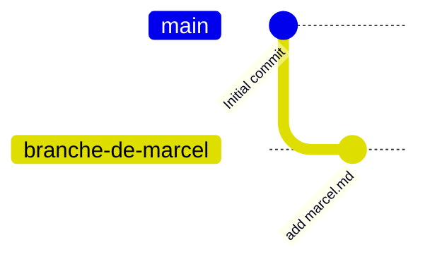

# Git branch

Découvrons un peu les branches et les Merge Requests ( MR ).

## Exercice 1

En travaillant à plusieurs sur un projet, il est fréquent de travailler sur des branches. Ou plutôt, c'est une mauvaise pratique de travailler directement sur la branche main. 

Une première pratique, souvent vue sur des projets étudiants mais déconseillé en règle générale, est de créer une branche par développeur. L'illusion étant que nous n'aurons plus de conflits de merge. 


```bash
git clone git@gitlab.com:docusland-courses/versionning/git-branch.git
cd git-branch
git switch --create branche-de-marcel
touch marcel.md
git add marcel.md
git commit -m "add marcel.md"
git push --set-upstream origin branche-de-marcel
```

Nous avons alors le dépôt suivant : 


Faites celà sur votre ordinateur. 
> Vous pouvez voir les branches locales sur votre ordinateur en faisant git branch
