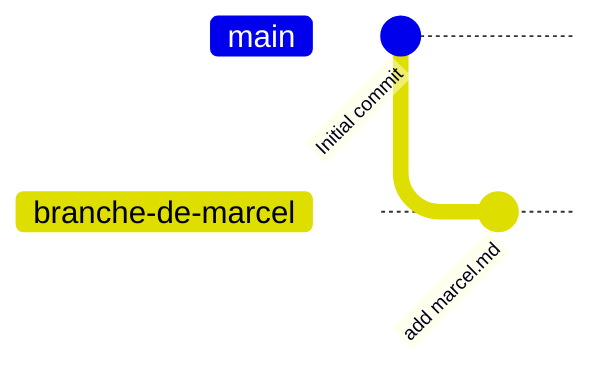
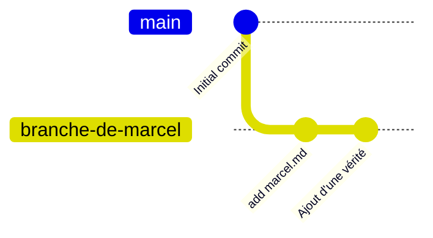
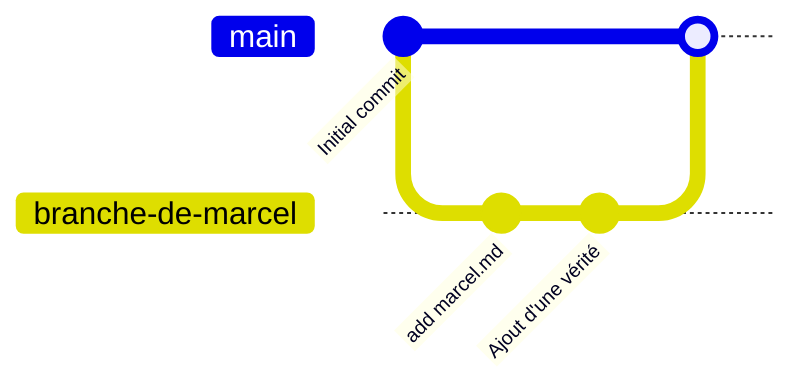
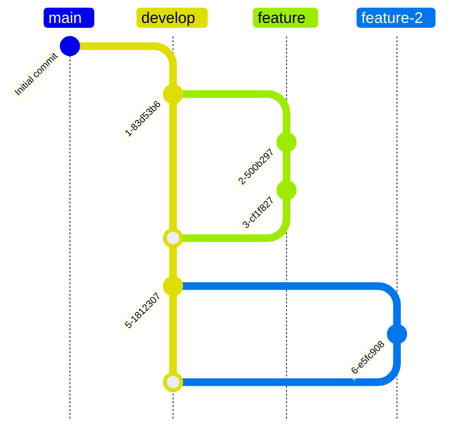
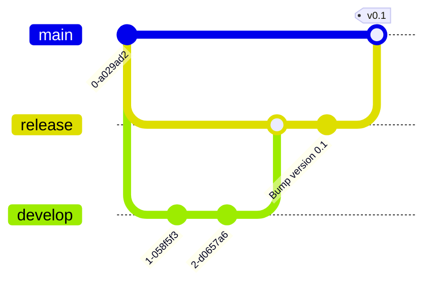

# Git branch

Découvrons un peu les branches et les Merge Requests ( MR ).

## Exercice 1

En travaillant à plusieurs sur un projet, il est fréquent de travailler sur des branches. Ou plutôt, c'est une mauvaise pratique de travailler directement sur la branche main. 

Une première pratique, souvent vue sur des projets étudiants mais déconseillé en règle générale, est de créer une branche par développeur. L'illusion étant que nous n'aurons plus de conflits de merge. 


```bash
git clone git@gitlab.com:docusland-courses/versionning/git-branch.git
cd git-branch
git switch --create branche-de-marcel
touch marcel.md
git add marcel.md
git commit -m "add marcel.md"
git push --set-upstream origin branche-de-marcel
```

Nous avons alors le dépôt suivant : 


Faites celà sur votre ordinateur. 
> Vous pouvez voir les branches locales sur votre ordinateur en faisant git branch


Lorsque vous basculez d'une branche à l'autre, par le biais de la commande `git switch <nom-de-la-branche>`, vous pourrez voir apparaître et disparaitre ce fichier.

Ajoutez du contenu dans le fichier marcel.md
```bash
echo "Marcel est trop fort" > marcel.md
git add marcel.md
git commit -m "Ajout d'une vérité"
git push
```



Maintenant que marcel a bien travaillé, il est temps de fusionner son travail dans la branche principale. 
```bash
git switch main
git merge branche-de-marcel
git push
```



Ici, la branche `branche-de-marcel` a été versionnée chez gitlab. Nous aurions pu ne jamais l'envoyer en ligne. ( jamais faire de push ) Cette branche aurait simplement été stockée sur votre ordinateur. 

Si une branche locale ne vous sert plus, vous pouvez la supprimer: 

```bash
git branch --delete branche-de-marcel
```


## Exercice 2
Après la sortie de git, un modèle de branches nommé "git flow" a été imaginé par M. Vincent Driessen. Il s'agit d'une première standardisation des branches qui a été mis en place dans de nombreuses entreprises. Vous trouverez une documentation [plus détaillée ici en anglais](https://nvie.com/posts/a-successful-git-branching-model/)

Le voici : 


Détail des branches : 
 - `main` : Branche des versions validées et tagguées
 - `develop`: Branch a partir de laquelle tout dev travaille, en constante évolution
 - `feature` : Branche partant de develop permettant d'implémenter une fonctionnalité. Ex : feature-user-can-log-in

Une fois que la branche develop semble satisfaisante, on la livre sur une branche release, validée par le client. Si ce dernier valide, le tout est migré sur la branche main avec un tag.



Reproduisez ce modèle de branch manuellement sur un projet solo.
Vous aurez besoin des commandes suivantes : 
- `git add` : Ajout d'un fichier dans le prochain commit
- `git commit` : Sauvegarde d'un état
- `git branch` : Lister les branches / Créer une branche
- `git checkout` : Bascule sur une branche ou un commit
- `git checkout -b` : Créé une branche et bascule dans cette dernière
- `git switch` : Bascule vers une branche
- `git merge` : Fusionner deux branches
- `git tag` : Ajoute un tag sur un commit

> Si celà vous intéresse, un outil a été implementé pour réaliser automatiquement ces branches. Il s'agit de [git-flow](https://danielkummer.github.io/git-flow-cheatsheet/)